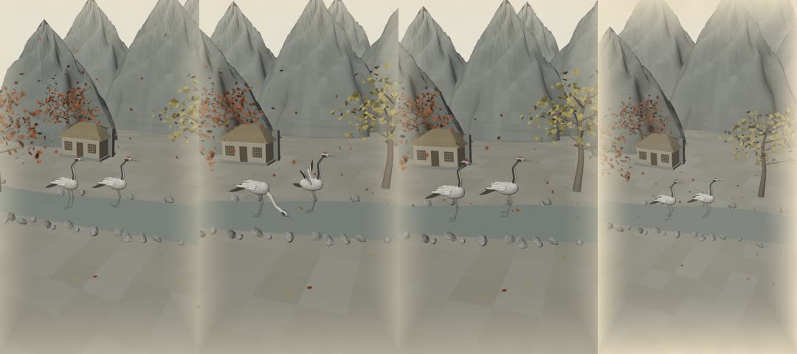

# 가을 산수화, 학 두 마리의 산책

Python과 Blender로 만든 실제 3D 애니메이션 프로젝트입니다. 외부 이미지, 다운로드한 3D 모델, 이미지 슬라이드쇼를 사용하지 않습니다. 모든 지형·나무·낙엽·학·초가집은 기본 메시와 곡선으로 생성합니다.

## 결과물

- `renders/autumn_cranes_15s.mp4`: 1080×1920, 9:16, 30fps, 정확히 450프레임 / 15.000초, H.264/yuv420p, 무음
- `autumn_cranes.blend`: 모든 메시·재질·IK 리그·450프레임 애니메이션을 포함한 Blender 프로젝트
- `scripts/create_scene.py`: 재현 가능한 장면 생성기
- `scripts/render_frames.py`: Blender 프레임 렌더링
- `scripts/encode.py`: 절차적 한지 마감 및 FFmpeg MP4 인코딩
- `scripts/rig_tools.py`: 포즈가 적용된 실제 모델의 450프레임 화면 경계/관절 검사
- `scripts/verify.py`: FFprobe 및 전체 디코딩 검증

[MP4 직접 다운로드](https://raw.githubusercontent.com/aa66161533-blip/motion-graphicsCapCut-motion-graphics-and-video-projects/main/autumn-cranes/renders/autumn_cranes_15s.mp4)

[Blender 프로젝트 다운로드](https://raw.githubusercontent.com/aa66161533-blip/motion-graphicsCapCut-motion-graphics-and-video-projects/main/autumn-cranes/autumn_cranes.blend)

갤럭시 탭에서는 Chrome에서 MP4 링크를 길게 누르고 **링크 다운로드**를 선택하세요. 재생 화면이 열리면 플레이어 메뉴의 **다운로드**를 선택합니다. 파일은 **내 파일 → 다운로드**에 저장됩니다. 원본 링크에서 메뉴가 보이지 않으면 GitHub의 해당 MP4 파일 페이지에서 **Download raw file**을 사용하세요.

## 설치

필수 프로그램:

1. [Blender 4.3.2](https://download.blender.org/release/Blender4.3/) (실행 검증 버전) — Blender 내부 Python에는 `bpy`와 `mathutils`가 포함되어 있습니다. 일반 Python에 `pip install bpy`를 할 필요가 없습니다.
2. Python 3.10 이상 — 한지 마감/인코딩용 스크립트 실행에 사용합니다.
3. [FFmpeg와 FFprobe](https://ffmpeg.org/download.html) — 두 실행 파일을 PATH에 추가합니다. Debian/Ubuntu의 `ffmpeg` 패키지, macOS의 `brew install ffmpeg` 등을 이용할 수 있습니다.

```bash
git clone https://github.com/aa66161533-blip/motion-graphicsCapCut-motion-graphics-and-video-projects.git
cd motion-graphicsCapCut-motion-graphics-and-video-projects/autumn-cranes
python -m pip install -r requirements.txt
```

## 완성된 Blender 파일 열기

```bash
blender autumn_cranes.blend
```

카메라 뷰는 숫자패드 `0`, 재생/정지는 `Space`입니다. 타임라인은 1–450프레임입니다. IK 목표, 목·날개·다리의 포즈, 바람과 낙엽, 연기, 카메라 애니메이션은 **일반 F-curve로 저장**되어 있어 외부 Python 핸들러나 자동 실행 스크립트 허용이 필요하지 않습니다. 뼈와 컨트롤은 영상에 렌더되지 않습니다.

## 한 번에 생성·렌더링·인코딩·검증

```bash
python scripts/run.py
```

Blender가 PATH에 없으면 실행 파일 경로를 지정합니다.

```bash
python scripts/run.py --blender /path/to/blender
```

중단한 프레임부터 이어서 렌더링하려면:

```bash
python scripts/run.py --resume
```

4K 프로젝트 및 영상을 새로 생성하려면:

```bash
python scripts/run.py --4k
```

4K 옵션은 2160×3840입니다. 이번 제공 MP4의 실제 렌더링·검증 해상도는 **1080×1920**이며, 4K 결과물을 완성본이라고 주장하지 않습니다. 해상도나 엔진을 변경할 때에는 이전 `renders/frames`를 지우고 `--resume` 없이 실행하세요.

## 단계별 실행

```bash
# 1. 실제 3D 장면과 애니메이션 생성
blender -b -t 4 -P scripts/create_scene.py -- --out . --resolution 1080

# 2. 주요 8개 시점의 작은 미리보기
blender -b autumn_cranes.blend -t 4 -P scripts/render_frames.py -- --sample --preview
python scripts/encode.py --sample

# 3. 최종 해상도로 정확히 450프레임 렌더링
blender -b autumn_cranes.blend -t 4 -P scripts/render_frames.py -- --resume

# 4. 한지 마감과 MP4 생성
python scripts/encode.py

# 5. 실제 MP4 규격, 리그 검사 기록, 전체 디코딩 확인
python scripts/verify.py
```

프레임 범위를 나누어 렌더링할 수도 있습니다. 예: `--start 1 --end 150`, `--start 151 --end 300`, `--start 301 --end 450`. 인코더는 1–450프레임이 정확히 모두 있는지 확인한 뒤 실행됩니다.

## 렌더 엔진과 스타일

제공 영상은 GPU가 없는 환경에서 실행한 Blender **Workbench** 렌더입니다. 재질의 담채 색상과 부드러운 스튜디오 조명, 화면 공간의 가는 먹선, 다층 지형과 실제 원근 카메라를 사용합니다. 프레임 렌더러의 기본 안티앨리어싱은 FXAA이며 `--aa 8` 또는 `--aa 16`으로 높일 수 있습니다. PNG 프레임은 실제 3D 렌더링 결과입니다.

생성기는 Eevee용 절차적 노이즈 재질 노드와 조명도 함께 만듭니다. GPU 환경에서 별도 Eevee 버전을 만들려면 `python scripts/run.py --engine eevee`를 사용하세요. Eevee와 4K 변형의 렌더 시간과 시각적 결과는 사용자의 GPU/환경에서 별도로 확인해야 합니다.

한지 마감은 외부 이미지 없이 고정 난수 시드로 만든 섬유·얼룩 텍스처를 사용합니다. `encode.py`는 **이미 렌더된 각 3D 프레임**에 종이 질감과 절제된 색상, 먹이 드러나는 시작, 오래된 그림으로 돌아가는 마지막 가장자리 마감을 합성합니다. 이 단계에서 학이나 카메라 움직임을 대신 생성하지 않습니다.

## 장면과 동작

| 시간 | 동작 |
| --- | --- |
| 0–3초 | 한지 위에서 산수화가 드러나고 카메라가 가을 풍경으로 전진 |
| 3–6초 | 같은 두 마리의 학을 개울가에서 관찰, 긴 다리로 천천히 걷기 |
| 6–10초 | A는 물을 마시고 B는 날개를 펼쳤다가 접기, 동심원 물결 |
| 10–13초 | 두 학이 함께 걷고 초가집 굴뚝 연기와 단풍잎이 움직임 |
| 13–15초 | 연속 카메라가 물러나고 한지 위의 산수화로 마무리 |

- 학은 **두 개의 동일한 해부학적 모델**만 사용하며 루트 스케일은 항상 1입니다.
- 각 학은 15개 뼈를 가진 Armature, 연속 목 메시, 3단 목 IK, 양쪽 다리 IK, 어깨/손목 관절과 겹친 입체 깃털을 가집니다.
- 걷기는 발을 딛는 구간과 들어 올리는 구간을 나누며, 접지 구간은 루트 이동을 상쇄합니다.
- 화면 경계 검사는 포즈가 적용된 메시를 기준으로 450프레임 모두 수행합니다.
- 앞의 나뭇잎·개울과 학·초가집·뒤의 산을 서로 다른 실제 깊이에 배치했습니다.
- 나무의 가지 관절과 잎 Shape Key, 낙엽 위치/회전, 물결, 안개 메시와 연기 메시가 움직입니다.
- 자막·로고·워터마크·현대식 건물·음성·배경음악은 넣지 않습니다.
- 바람·물결·연기는 수묵담채화에 맞춘 절차적 애니메이션이며 유체 물리 시뮬레이션은 사용하지 않습니다.

검증 여부는 `renders/verification.json`과 `renders/rig-check.json`의 `passed` 값으로 확인하세요. 렌더 프레임 시퀀스는 용량 때문에 Git에 포함하지 않으며 위 명령으로 다시 생성할 수 있습니다.

## 이번 제작의 실제 검증

- Blender 4.3.2에서 최종 Python 생성기를 별도 실행해 장면 생성 성공.
- 450개 시점에서 포즈 적용 모델의 화면 경계 검사 통과, 학 Armature 2개.
- 물 마시기 중 부리 끝 높이 0.0623, 수면 높이 0.052 (장면 단위).
- 최종 1080×1920 프레임 450개를 실제 Blender에서 렌더링.
- FFprobe: H.264, 1080×1920, 30/1 fps, 450프레임, 15.000초, 오디오 없음.
- FFmpeg 전체 영상 디코딩 오류 없음.
- 완성 MP4: 15,674,037 bytes.


