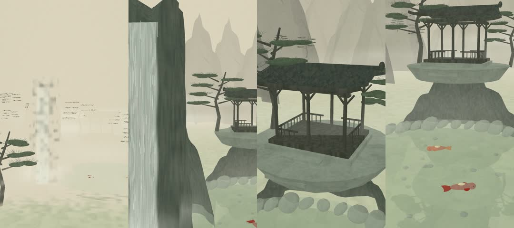

# 선경(仙境), 구름 속의 정원

한국 전통 수묵 산수화를 소재로 한 **실제 Three.js / WebGL2 3D 애니메이션**입니다. 정지 이미지 확대나 이미지 슬라이드쇼를 사용하지 않습니다. 장면 전체가 하나의 연결된 3D 공간이며 카메라 컷 없이 15초 동안 이동합니다.

## 최종 영상

- `renders/seongyeong_15s_3d.mp4`
- 1080 × 1920, 세로 9:16, 30fps, 정확히 450프레임 / 15.000초
- H.264 / yuv420p / MP4 faststart, 오디오 트랙 없음
- 영상 안에는 자막, 로고, 워터마크가 없습니다. 프로젝트 이름은 브라우저 탭에만 표시됩니다.
- `renders/verification.json`: FFprobe, 전체 디코딩 및 브라우저 캡처 검증 결과
- `renders/SHA256SUMS`: 최종 MP4의 SHA-256

저장소의 파일 페이지에서 **Download raw file**을 누르거나 아래 원본 링크를 엽니다.

[MP4 다운로드](https://raw.githubusercontent.com/aa66161533-blip/motion-graphicsCapCut-motion-graphics-and-video-projects/main/seongyeong/renders/seongyeong_15s_3d.mp4)

갤럭시 탭에서는 Chrome에서 위 링크를 길게 누르고 **링크 다운로드**를 선택하세요. 영상이 열리면 플레이어 메뉴의 **다운로드**를 선택합니다. 파일은 **내 파일 → 다운로드**에 저장됩니다. 원본 링크에서 메뉴가 나오지 않으면 GitHub 파일 페이지의 **Download raw file**을 사용하세요.

## 설치 및 브라우저 실행

필수: Node.js 20.19+ 또는 22.12+ (이 프로젝트의 검증 환경: Node.js 24), npm, Chromium, FFmpeg/FFprobe.

```bash
git clone https://github.com/aa66161533-blip/motion-graphicsCapCut-motion-graphics-and-video-projects.git
cd motion-graphicsCapCut-motion-graphics-and-video-projects/seongyeong
npm ci
npx playwright install chromium
npm run dev
```

터미널에 표시된 localhost 주소를 브라우저에서 여세요. 자동 재생, 일시정지, 다시 보기, 시간 탐색을 지원합니다. 캔버스 바깥 재생 도구는 영상에 포함되지 않습니다. 데스크톱/태블릿에서 WebGL2 하드웨어 가속을 권장합니다. 서버를 네트워크에 공개할 경우 방화벽과 접근 범위는 사용자가 설정해야 합니다.

```bash
npm run build       # 배포용 정적 웹 앱 생성
npm run preview     # dist 빌드 실행
```

## MP4 생성

FFmpeg와 FFprobe를 설치하고 PATH에 추가하세요. Ubuntu/Debian에서는 패키지 관리자로 `ffmpeg`를 설치하면 두 실행 파일이 함께 설치됩니다. macOS는 `brew install ffmpeg`, Windows는 FFmpeg 공식 배포 안내에 따라 설치할 수 있습니다.

```bash
npm run render -- --sample   # 8개 주요 시점, 브라우저 오류 검사
npm run render              # Chromium에서 0/30 … 449/30초를 각각 캡처 후 인코딩
npm run verify              # 규격, 프레임 수, 전체 디코딩, 카메라 연속성 확인
npm run check:browser       # 재생 도구, 동일 시점 재현성, 카메라 경계, WebGL 오류 검사
```

`scripts/render.mjs`는 Vite 서버를 자동 시작/종료하고, 시스템 `/usr/bin/chromium`이 있으면 사용합니다. 없으면 Playwright가 설치한 Chromium을 사용합니다. 별도 Chromium 경로를 지정하려면 `CHROMIUM_PATH` 환경 변수를 사용하세요. 예: `CHROMIUM_PATH=/path/to/chromium npm run render`.

렌더링은 그래픽 드라이버가 없는 환경에서도 동작하도록 SwiftShader 옵션을 사용합니다. GPU 환경에서는 필요에 따라 `scripts/render.mjs`의 `--use-angle=swiftshader` 옵션을 제거할 수 있습니다. GPU/브라우저에 따라 미세한 셰이더 픽셀 차이는 생길 수 있지만 시간, 카메라 경로, 450프레임 규격은 같습니다.

캡처는 벽시계나 재생 속도에 의존하지 않습니다. 매 프레임 `window.renderAt(frame / 30)`을 호출해 장면 상태를 직접 계산합니다. 캡처 원본은 고품질 JPEG(quality 0.97)로 저장하며 캡처 디렉터리는 Git에 포함하지 않습니다. 최종 MP4 및 검증 결과는 포함합니다.

FFmpeg만 별도로 재실행하려면:

```bash
ffmpeg -y -framerate 30 -start_number 0 -i renders/frames/frame-%04d.jpg \
  -frames:v 450 -c:v libx264 -preset slow -crf 18 -pix_fmt yuv420p \
  -r 30 -an -movflags +faststart renders/seongyeong_15s_3d.mp4
```

## 구현과 연출

| 시간 | 연출 |
| --- | --- |
| 0–4초 | 한지의 여백에서 먹빛 산봉우리가 나타나며 계곡으로 전진 |
| 4–8초 | 높은 바위 절벽을 흐르는 폭포와 아래 물안개를 옆으로 통과 |
| 8–12초 | 절벽 위 정자의 기둥·난간·기와지붕을 곡선 경로로 관찰 |
| 12–15초 | 고요한 연못 쪽으로 내려가며 붉은색·주황색 잉어 두 마리를 관찰, 카메라 감속 |

- 원근 카메라와 시간 구간별 C1 연속 Hermite 경로. 마지막 카메라 속도는 0으로 수렴합니다.
- 앞/뒤 깊이가 다른 28개 방사형 높이 지형, 별도 폭포 절벽과 정자 암반.
- 월드 좌표에 고정된 담묵 노이즈·준선 셰이더, 깊이 기반 거리 안개, 화면 공간의 한지 섬유 질감.
- 폭포 셰이더의 흐르는 수직 패턴과 실제로 아래로 이동하는 물줄기 메시, 월드 공간 물안개 스프라이트.
- 정자는 6개 원기둥 기둥, 도리·보·난간·계단, 곡면 기와지붕과 타일 능선으로 만든 실제 3D 구조물입니다.
- 소나무는 3D 줄기/가지, 솔잎 덩어리 및 선형 솔잎으로 구성됩니다. 바람은 시간 기반 꼭짓점 변위와 솔잎 그룹 회전으로 표현합니다.
- 연못의 동심원 파동과 별도 반사 카메라/렌더 타깃을 이용한 평면 반사. 물 아래의 잉어는 정확히 두 개의 3D 개체이며 닫힌 Catmull–Rom 곡선과 꼬리 관절을 따라 움직입니다.
- 브라우저에서 실시간 재생 성능은 기기에 따라 달라집니다. 오프라인 MP4는 렌더링 속도와 무관하게 30fps입니다.
- 폭포와 반사 등은 수묵화풍의 절제된 근사 표현이며 유체 물리 시뮬레이션은 사용하지 않습니다.

## 파일 구성

```text
index.html                  브라우저 플레이어
src/main.js                 3D 공간, 메시, 셰이더, 카메라 및 애니메이션
scripts/render.mjs          Playwright 프레임 캡처 + FFmpeg
scripts/verify.mjs          FFprobe/디코딩/캡처 검증
package-lock.json           패키지 버전 고정
renders/                    최종 MP4, 시점별 미리보기, 검증 기록
```

검증되지 않은 영상은 완료본으로 취급하지 않습니다. 최종 결과 여부는 `npm run verify`가 생성한 `renders/verification.json`의 `passed` 필드로 확인합니다.

## 이번 실행의 검증 결과

- Chromium/WebGL2에서 450개 프레임을 실제 캡처했습니다.
- FFprobe: 1080×1920, H.264, 30/1 fps, 450프레임, 15.000초, 오디오 트랙 없음.
- FFmpeg 전체 디코딩 오류 없음.
- 브라우저 재생/정지/탐색/다시 보기, 동일 시점 재현성 및 카메라 경계 연속성 검사 통과.
- 최종 파일 크기: 20,937,351 bytes.


