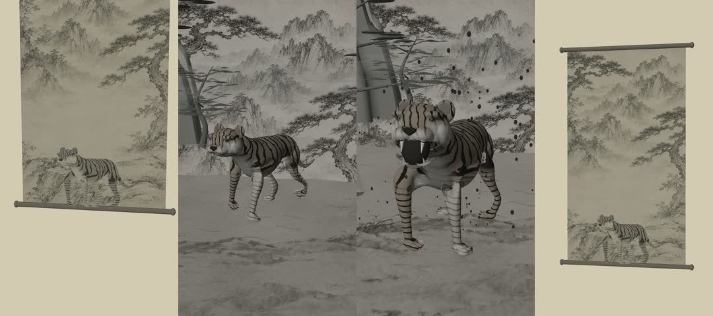

# The Tiger in the Ink Scroll

A 15-second vertical, continuous-camera Blender animation inspired by Joseon ink-wash landscapes. The film begins as an aged hanji scroll, follows the tiger's awakening and emergence into a three-dimensional landscape, and returns to the original painting through a continuous ink dissolve.

## Deliverables

- `renders/tiger_scroll_15s_4k.mp4` — native **2160×3840**, 9:16, **24 fps, 360 frames, 15.000 seconds**, H.264/yuv420p, no audio.
- `tiger_scroll.blend` — self-contained model, textures, rig and baked animation; no Python handlers or script auto-run required for playback.
- `scripts/` — reproducible construction, rig checks, frame rendering, ink finish, encoding and verification.
- `renders/verification.json` — checks on the actual encoded MP4.
- `assets/LICENSES.md` — provenance and licensing of the adapted tiger study and the generated landscape painting.

[Download the 4K MP4](https://raw.githubusercontent.com/aa66161533-blip/motion-graphicsCapCut-motion-graphics-and-video-projects/main/tiger-scroll/renders/tiger_scroll_15s_4k.mp4)

[Download the Blender project](https://raw.githubusercontent.com/aa66161533-blip/motion-graphicsCapCut-motion-graphics-and-video-projects/main/tiger-scroll/tiger_scroll.blend)

On a Galaxy Tab, open the MP4 link in Chrome and choose Download from the player menu, or long-press the link and choose **Download link**. The file appears in **My Files → Downloads**. The GitHub file page also provides **Download raw file**.

## Timeline

| Time | Animation |
| --- | --- |
| 0–3 s | A real textured hanji scroll, painted mountains and pines, and a depth-compressed tiger; the perspective camera pushes closer. |
| 3–6 s | A baked eyelid deformation closes and opens the eyes. The head turns while a procedural ink wash spreads over the page. |
| 6–8 s | The tiger's geometry expands from 0.065 depth to full volume. The scroll fades as the articulated tiger steps onto a three-dimensional ledge. |
| 8–13 s | IK walking, body balance and tail motion advance the tiger toward the camera. Actual foreground pines, rock geometry and layered mountains create parallax against a distant painted atmosphere. |
| 13–15 s | The neck raises, the jaw opens for a silent roar, and 3D ink particles swirl. A gradual, nonuniform ink dissolve restores the opening painting. |

There are no hard cuts, on-screen text, subtitles, logos, watermarks, speech or music.

## Implementation

The tiger uses a **CC0 Innerscene anatomical study**, adapted to a new **28-bone rig**, foot IK, eyelid shape keys, jointed tail, head and jaw animation. The source study is static: the walking, blink, head turn, oral opening, canines, tongue and transformation are authored in this project. The lower mandible is separated along the lip boundary so the mouth can open geometrically. See [asset provenance](assets/LICENSES.md) and the [original model page](https://www.innerscene.com/tools/library/3d-parts/tiger-3a01b408).

The render is a stylized ink-art interpretation using Blender **Workbench** studio shading, surface textures, fine cavity lines and layered mist geometry. It is not a path-traced fur simulation. The film is rendered at native 4K, rather than enlarging a 1080p video. A distant painted atmosphere is used behind actual 3D foreground layers, as a sky/background treatment; the tiger and its motion are genuine skinned geometry.

The final ink grading, spreading wash and return to the original painting are applied to the genuine rendered frames by `encode.py`. The final dissolve uses the opening render as its restoration target. It does not replace the tiger's movement with a still-image slideshow. The opening and closing source posters are checked for equality.

## Requirements

- **Blender 4.3.2**, the version used for execution and rendering. [Official release files](https://download.blender.org/release/Blender4.3/).
- Python 3.10+ for postprocessing.
- FFmpeg and FFprobe on PATH. [Installation](https://ffmpeg.org/download.html).
- NumPy and Pillow: `python -m pip install -r requirements.txt`.

Blender supplies its own `bpy` and `mathutils`. Do not install `bpy` into the ordinary Python environment.

```bash
git clone https://github.com/aa66161533-blip/motion-graphicsCapCut-motion-graphics-and-video-projects.git
cd motion-graphicsCapCut-motion-graphics-and-video-projects/tiger-scroll
python -m pip install -r requirements.txt
python scripts/run.py
```

If Blender is not on PATH:

```bash
python scripts/run.py --blender /path/to/blender
```

Resume an interrupted render without rebuilding the saved scene:

```bash
python scripts/run.py --resume
```

## Individual steps

```bash
# Build the self-contained 4K scene and 360-frame animation.
blender -b -t 4 -P scripts/build.py

# Check the actual baked blink, dimensional expansion, jaw and continuous camera.
blender -b tiger_scroll.blend -t 2 -P scripts/check_scene.py

# Eight 1080×1920 preview frames, not a final 4K render.
blender -b tiger_scroll.blend -t 4 -P scripts/render.py -- --sample --percent 50
python scripts/encode.py --sample

# Native 2160×3840 frame rendering, frame 1 through frame 360.
blender -b tiger_scroll.blend -t 4 -P scripts/render.py -- --percent 100 --resume

# Ink finish and silent H.264 encoding, then actual-file verification.
python scripts/encode.py
python scripts/verify.py
```

Frame ranges can be split with `--start 1 --end 120`, etc. The encoder refuses to proceed unless frames 1–360 all exist. Intermediate frames are high-quality JPEGs (quality 97). They are excluded from Git because of their size; the final film, project and validation records are included.

The encoder uses CRF 18 with a 40 Mbps VBV ceiling and MP4 faststart for practical tablet playback and download size. No audio stream is created.

## Opening the project

```bash
blender tiger_scroll.blend
```

Use Numpad 0 for camera view and Space for playback. The animation is baked into ordinary F-curves and shape keys. The image textures are packed into the project; the source GLB and painting are also provided for rebuilding.

The render and encoded-file checks must pass before treating an output as complete. Consult `renders/rig-check.json` and `renders/verification.json`.

## Mobile viewing copy

[Download the 1080×1920 mobile MP4](https://raw.githubusercontent.com/aa66161533-blip/motion-graphicsCapCut-motion-graphics-and-video-projects/main/tiger-scroll/renders/tiger_scroll_15s_mobile.mp4)

The mobile file is a separate 24 fps, 15-second, silent H.264 copy made from the verified 4K master. The native 4K master is preserved. To reproduce this optional viewing copy:

```bash
ffmpeg -i renders/tiger_scroll_15s_4k.mp4 -vf scale=1080:1920 \
  -c:v libx264 -preset fast -crf 19 -an -movflags +faststart \
  renders/tiger_scroll_15s_mobile.mp4
```

## Completed-file checks

- Native render: 360 frames at 2160×3840.
- Encoded master: H.264, 24/1 fps, 15.000 seconds, no audio stream.
- Full decoding passed.
- Opening and closing source image pixels match exactly; the encoded first/last mean pixel error is 0.518 on the 0–255 scale.
- The 1080×1920 viewing copy also passed frame-count, duration, silence and decoding checks.


